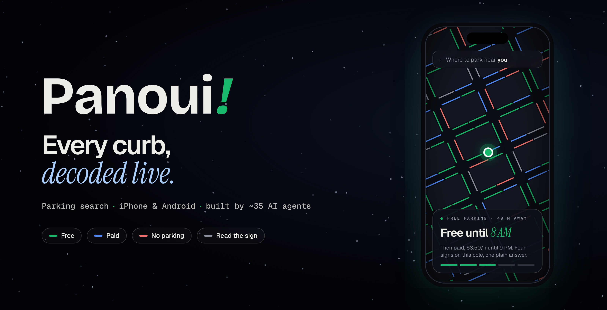
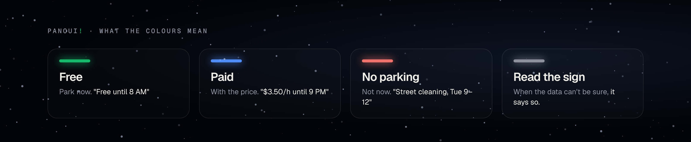
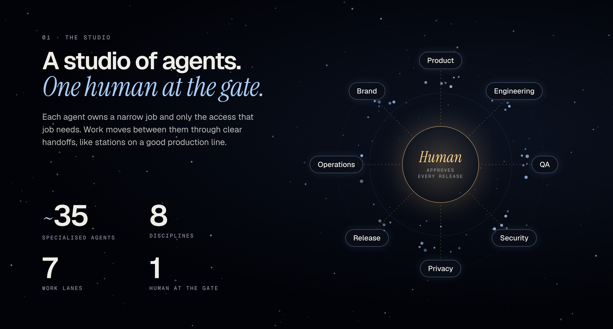
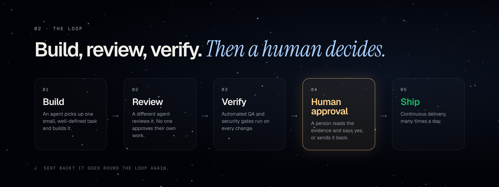
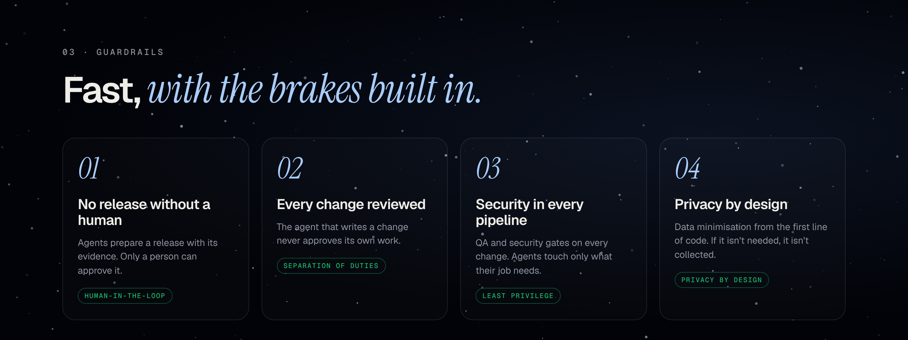

  

  <a href="https://panoui.com"><b>panoui.com</b></a> &nbsp;·&nbsp; Free on iPhone and Android &nbsp;·&nbsp; Search <b>Panoui!</b> in the App Store or Google Play

> **This is a showcase repository.** The source code is private. This page explains what Panoui! does and how it is built.

## What it does

Four signs on one pole. One plain answer.

Panoui! shows where you can park right now. Curb lines are colour-coded live, built from the city's own official open data. Tap a spot and get a plain answer, like *"Free until 8 AM"*.

## How it's built

Panoui! is designed, built, tested and shipped by a studio of AI agents that I set up. I set the direction, read the evidence, and approve each release or send it back. The agents do most of the typing. I do most of the saying no.

Each agent owns a narrow job and only the access that job needs. Work moves between them through clear handoffs, the way it moves between stations on a good production line.

Every change goes round the same loop, many times a day. Nothing ships until a person has read the evidence and said yes.

## At a glance

| | |
| --- | --- |
| **Product** | Parking search: live, colour-coded curbs and plain-language answers |
| **Platforms** | iPhone and Android, plus a web app (PWA) |
| **Stack** | TypeScript · Cloudflare |
| **Team** | One human founder and a studio of ~35 specialised AI agents |
| **Practices** | Multi-agent orchestration · human-in-the-loop · least-privilege agents · continuous delivery · automated QA and security gates · privacy by design |

## About

Panoui! is my own initiative. I'm Igal Taflev, and I put AI to work and keep it accountable. More about me at [taflev.com](https://taflev.com) and on [LinkedIn](https://www.linkedin.com/in/igal-taflev).

Happy to walk through the agent setup, the loop and the guardrails in a conversation.

---

Street data: Ville de Montréal open data (CC BY 4.0). Panoui! is not affiliated with the city. Screens and prices in the images above are illustrative.
